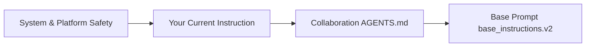

<div align="center">

<h1>What Your Codex Needs</h1>

<p><strong>A two-layer Codex configuration for clear, reliable engineering collaboration</strong><br>
<sub>Natural prose · Proportionate tests · Zero CYA disclaimers · Clear autonomy boundaries</sub></p>

<p>
  <a href="./AGENTS.en.md"></a>
  <a href="./base_instructions.v2.md"></a>
  
  <a href="./README.md"></a>
</p>

<p>
  <a href="./AGENTS.en.md"><kbd>Collaboration AGENTS.en.md</kbd></a>&nbsp;
  <a href="./base_instructions.v2.md"><kbd>Base Prompt v2 (EN)</kbd></a>&nbsp;
  <a href="./base_instructions.v2.zh.md"><kbd>Base Prompt v2 (ZH)</kbd></a>&nbsp;
  <a href="#how-to-use"><kbd>Quick Start</kbd></a>&nbsp;
  <a href="./README.md"><kbd>中文</kbd></a>
</p>

</div>

---

I want Codex to work like a sharp engineering colleague: fix a typo on a Save button directly and verify it; audit callers and propose one migration plan before changing a public API; switch strategies on repeated failures and stop with the key log line when genuinely stuck; and lead with clear judgment in everyday discussion.

## Two Layers, Clear Separation

<table>
  <tr>
    <td width="50%" valign="top">
      <h3><kbd>Layer 1</kbd> Collaboration · <code>AGENTS.en.md</code></h3>
      <p><sub>Recommended for everyone · Version-safe · Zero protocol lock-in</sub></p>
      <ul>
        <li><strong>Communication</strong>: lead with judgment, separate facts from assumptions, cut filler</li>
        <li><strong>Workflow</strong>: <strong>Dual-Plan</strong> for new features, direct execution for small fixes</li>
        <li><strong>Circuit breakers</strong>: switch after 2 failures, stop and report after 2 failed alternatives</li>
        <li><strong>Engineering rails</strong>: inspect call sites first, no unrequested commits/pushes</li>
      </ul>
      <p>→ <a href="./AGENTS.en.md"><strong>Read AGENTS.en.md</strong></a> (<a href="./AGENTS.md">中文版</a>)</p>
    </td>
    <td width="50%" valign="top">
      <h3><kbd>Layer 2</kbd> Base Prompt · <code>base_instructions.v2</code></h3>
      <p><sub>Advanced / optional · Replaces stock system prompt · All tool contracts intact</sub></p>
      <ul>
        <li><strong>Fix telegraph prose</strong>: drop punctuation &amp; contrast blacklists for natural writing</li>
        <li><strong>Fix test laziness</strong>: flip default test-skipping into proportionate verification</li>
        <li><strong>Drop CYA caveats</strong>: replace blanket <code>MUST</code> self-blame with 3 checkable disclosures</li>
        <li><strong>Close safety rails</strong>: forbid weakening auth/TLS to pass tests; add countable stop-loss</li>
      </ul>
      <p>→ <a href="./base_instructions.v2.md"><strong>English Production</strong></a> · <a href="./base_instructions.v2.zh.md">Chinese Reference</a></p>
    </td>
  </tr>
</table>



> [!TIP]
> **Not sure where to start? Begin with `AGENTS.en.md` alone.**
> It solves most day-to-day collaboration friction without touching internal tool signatures. When both layers are active, stricter thresholds in your `AGENTS.md` and direct current instruction automatically take precedence.

---

## Collaboration Layer: Three Prompts, Three Behaviors

| What you say | What you expect Codex to do | Rule |
| :--- | :--- | :--- |
| **"Fix the typo on the Save button."** | Locate the real UI string, update it, and verify the result. Leave nearby refactoring for another task. | <kbd>Minimal Diff</kbd> |
| **"Rename `name` to `displayName` on the API."** | Check every caller reading `name`, propose **one preferred migration plan** with impact and risks, and wait for approval. | <kbd>Confirm High-Risk</kbd> |
| **"Why is this still throwing the same error?"** | Switch strategy after 2 failures; if the 2nd alternative still fails, stop editing and hand over what was tried, where it is stuck, and the key error. | <kbd>Circuit Breaker</kbd> |

For new products or features with unresolved behavioral trade-offs, use the **Dual-Plan Workflow**: align on *what* to build first (Product Plan), then align on *how* to build and verify it (Implementation Plan); routine fixes skip both rounds. [Read Dual-Plan rules →](./AGENTS.en.md#dual-plan-workflow)

---

## Base Prompt Layer: Stock Prompt Pain Points vs. `v2`

Some habits live inside the stock `base_instructions` and are hard to suppress from `AGENTS.md` alone. Here is what `v2` replaces at a glance:

```diff
# 1. Writing style: remove punctuation & contrast blacklists that cause choppy fragments
- In prose, do not use semicolons or colons; NEVER use contrastive framing ("X, not Y").
- Never state what something is not or what will remain unchanged.
+ Use colons, semicolons, transitions, and brief contrasts whenever they clarify causality or scope.
+ Cut only filler, self-praise, invented jargon, and unsolicited advice.

# 2. Verification & tests: reverse the default "skip new tests" laziness loop
- Skip new tests unless requested, required by the repo, or catching a missed regression.
+ Use declared repo check entry points (README/scripts/Makefile/CI) and verify baseline attribution.
+ Add focused tests for bug fixes, non-trivial logic changes, and regression risks; skip only for trivial/covered/opt-out cases.

# 3. Disclosures, security & stop-loss: remove defensive caveats, add hard rails
- Mention any flaws or unguided decisions; you MUST repeat any such disclosures in final.
- Only forbids hypothetical-risk warnings (no rule against weakening auth/TLS to make tests pass).
+ Disclose only 3 checkable items when present: behavioral assumptions, unverified areas, unresolved risks.
+ Never disable auth, validation, TLS, or sandboxes to make code pass (explicit local/test mocks excepted).
+ Switch hypothesis after 2 failures; pause and report after 3 distinct hypotheses fail without progress.
```

> [!NOTE]
> **Citation scope**: For copyright and maintenance reasons, this repo does not host OpenAI's raw system prompt verbatim. Only distilled mechanisms behind the three core defects are referenced above (in testing, the stock contrast ban even caused Codex to silently drop *"not as a continuation of intermediate commentary"* and *"rather than replacing it"* when translating its own rules, while the stock prompt itself used colons after list labels in its own Plugins section).

<details>
<summary><strong>Expand: Preserved Codex runtime contracts and base-layer scoping rules</strong></summary>

<br>

**Scoping rule**: Keep only principles that hold across every repository in the base layer; leave project-specific or personal workflow details to `AGENTS.md` and on-demand `SKILL.md` files. Also fixes two typos from the stock prompt (`maketo`, `tools_search`) and trims ~20% redundant repetition.

| Contract Area | Preserved in `v2` |
| :--- | :--- |
| **Channels & Steering** | `commentary` / `final` roles, opening with `commentary` before tool calls, self-contained `final` answers; `functions.request_user_input_async` / `functions.send_message_to_user_async`, waiting windows, mid-task steering, compaction continuity, plus a `final` fallback when async question tools are unavailable |
| **Formatting & Visuals** | GitHub-flavored Markdown, CommonMark blank-line spacing, clickable local file links (angle brackets for spaces, no backticks or URIs, no line ranges), four-tier visualization selection (interactive/inline, standalone plots, Mermaid, tables/lists) |
| **Tools & Shell** | `rg` / `rg --files`, batched read-only `functions.exec` via `await Promise.allSettled([...])`, no decorative separators, `JSON.stringify()` non-shell-escaping warning, `gh --body-file` newline/escape fidelity, 60-second blocking wait/poll cap, never repurposing `$HOME`/`$home`/`$CODEX_HOME` |
| **Extensions & Frontend** | Skills (`r0` alias expansion, environment-owned and orchestrator `skills.list` / `skills.read` / `skill://`), Apps (`codex_apps` / `tool_search` / never calling `list_mcp_resources*`), Plugins (`plugin_name:` and MCP `provenance`), frontend visuals/copy restraint/interactive states & accessibility, and the full 65-font catalog |

</details>

---

## How to Use

### <kbd>Step 1</kbd> Set up `AGENTS.en.md` (Recommended for Everyone)

1. Open [AGENTS.en.md](./AGENTS.en.md) and trim or adjust any clauses to match your style (such as circuit-breaker counts or Dual-Plan usage).
2. Put it at `~/.codex/AGENTS.md` for global use, or at your repository root as `AGENTS.md` (merge into existing files while keeping project build/test commands). See the [official Codex AGENTS.md guide](https://developers.openai.com/codex/guides/agents-md).

### <kbd>Step 2</kbd> Replace Base Instructions (Optional / Advanced)

1. Copy [base_instructions.v2.md](./base_instructions.v2.md) to `~/.codex/base_instructions.v2.md`.
2. Enable `model_instructions_file` in `~/.codex/config.toml`:

```toml
# Relative paths resolve from the .codex/ directory containing config.toml
# The older experimental_instructions_file key is deprecated
model_instructions_file = "base_instructions.v2.md"
```

3. Start a new Codex session and try a small real task (such as fixing a form message or small bug) to verify that it locates real call sites, keeps diffs tight, runs checks, and reports clearly.

---

## Version & Compatibility

> [!WARNING]
> `base_instructions.v2.md` is aligned with Codex tool and channel contracts as of November 2026 (tested on `codex-cli 0.172.0`). Because `model_instructions_file` replaces the entire built-in base prompt, future major Codex upgrades that change built-in tool names or Skills/Apps protocols may break older overrides. Review the tool contract sections against the latest built-in instructions after major updates.
