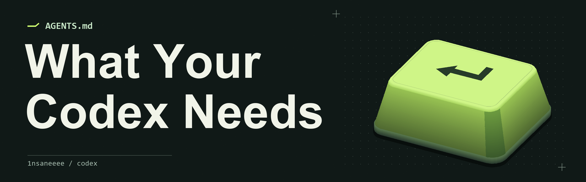

# What Your Codex Needs

[中文版 (README.md)](./README.md)　·　[中文 AGENTS.md](./AGENTS.md)

I want Codex to work like a reliable engineering colleague: fix a typo on a save button directly and verify it; check callers and propose a migration plan before changing a public API; stop spinning after repeated failures and hand me the most useful log line; and in everyday questions, lead with a clear judgment and the reason behind it — no fluff, no telegraphic fragments, no defensive disclaimers.

This repo provides a **two-layer Codex setup**: a practical collaboration guide ([AGENTS.en.md](./AGENTS.en.md) / [AGENTS.md](./AGENTS.md)) for day-to-day work, paired with an optional rewritten base system prompt ([base_instructions.v2.md](./base_instructions.v2.md)) that fixes structural defects in the default prompt.

**[AGENTS.en.md](./AGENTS.en.md)**　·　**[base_instructions.v2.md](./base_instructions.v2.md)**　·　[Chinese Reference](./base_instructions.v2.zh.md)　·　[Quick Start](#how-to-use)

## Two Layers, Clear Separation

| Layer | File | What it handles | Recommendation |
| :--- | :--- | :--- | :--- |
| **Collaboration Layer** | [AGENTS.en.md](./AGENTS.en.md) ([中文](./AGENTS.md)) | Communication habits, Dual-Plan workflow, 2-failure circuit breakers, Git and verification discipline | **Recommended for everyone** — touches no internal tool protocols and never breaks across Codex upgrades |
| **Base Prompt Layer** | [base_instructions.v2.md](./base_instructions.v2.md) ([中文](./base_instructions.v2.zh.md)) | Fixes writing-style blacklists, default test-skipping, defensive disclosures, and missing safety/stop-loss rails in the stock prompt | **Advanced / optional** — replaces the built-in base prompt via `model_instructions_file` |

You can use either layer independently or stack both. When both are active and thresholds differ (for example, `AGENTS.en.md` forbids unrequested commits/pushes and stops after 2 strategy switches, whereas the generic base layer allows draft PRs when requested and stops after 3 distinct hypotheses), your `AGENTS.en.md` and direct current instruction take precedence.

## Collaboration Layer (`AGENTS.en.md`): Three Prompts, Three Behaviors

| What I say | What I expect Codex to do |
| :--- | :--- |
| **"Fix the typo on the Save button."** | Find the real UI string in use, update it, and verify the result. Leave any nearby refactoring for another task. |
| **"Rename `name` to `displayName` on the API."** | Audit every caller reading `name`, propose one preferred migration plan with impact and risks, and wait for my go-ahead. |
| **"Why is this still throwing the same error?"** | Switch strategy after two failures on the same approach. If the second alternative still fails, stop editing and show what you tried, where it is stuck, and the key error. |

For new products or features with real behavioral trade-offs, use the **Dual-Plan Workflow**: align on *what* to build first (Product Plan), then align on *how* to build and verify it (Implementation Plan). Small fixes skip both rounds. [Read Dual-Plan rules](./AGENTS.en.md#dual-plan-workflow)

## Base Layer (`base_instructions.v2`): Why Rewrite the System Prompt

Most habits can be governed by `AGENTS.en.md` alone, but the stock `base_instructions` contains several patched-on conflicts that an outer file cannot always override. `v2` rewrites those behavioral instructions from scratch while preserving every Codex runtime contract.

> For copyright and maintenance reasons, this repo does not host OpenAI's raw system prompt verbatim. Only short representative excerpts are cited below to explain what `v2` fixes.

### 1. Remove punctuation and contrast blacklists that produce choppy "telegraph prose"

The stock prompt piles on syntactic bans:

> *"NEVER use contrastive framing such as 'X, not Y' ... Never add what you won't do, state what something is not, what will remain unchanged..."*
> *"In prose, do not use semicolons. Do not use colons to introduce explanations or examples, including after list labels."*

In practice, this triggers pink-elephant fixation and mangled syntax: to dodge colons, semicolons, and contrasts, the model chops causal reasoning into abrupt fragments — and even silently drops critical negative boundaries when rewriting text (such as dropping *"not as a continuation of intermediate commentary"* and *"rather than replacing it"*). Meanwhile, the stock prompt itself uses colons after list labels in its own Plugins section (`Skill naming:`), causing inconsistent compliance.

**How `v2` fixes it**: Drops all punctuation, transition, and contrast blacklists in favor of positive colleague-grade prose principles — lead with the point, use colons/semicolons/transitions/brief contrasts whenever they clarify causality or scope boundaries, and cut only filler, self-praise, and unsolicited advice.

### 2. Reverse the default "skip new tests" laziness loop

While asking for thorough verification up top, the stock coding guidelines default to skipping tests in clause `(c)`:

> *"Skip new tests unless requested, required by the repo, or needed to catch a specific regression existing tests would miss."*

Combined with "avoid unrequested artifacts", this encourages minimal-effort handoffs whenever the user does not explicitly ask for tests.

**How `v2` fixes it**: Splits verification into two clean rules — (1) discover and use the repo's declared check entry points (README, scripts, Makefile, CI), check baseline status, and attribute failures accurately; (2) verify through real entry points and add focused tests for bug fixes, non-trivial logic changes, and regression risks, skipping new tests only for trivial edits, already-covered behavior, repos lacking a test harness where adding one is out of scope, or explicit user opt-out.

### 3. Eliminate defensive disclaimers and close security / stop-loss gaps

The stock prompt forbids preemptive disclaimers in one section yet mandates self-disclosure with `MUST` in another:

> *"mention any relevant flaws in your work or any decisions you made without explicit guidance ... You MUST repeat any such disclosures in the final answer."*

It also includes a one-sided "skip hypothetical-risk warnings" rule without a counterpart forbidding the model from disabling auth/validation/TLS to make tests pass, lacks a countable stop-loss threshold on blockers, and leaves no fallback if async question tools are unavailable.

**How `v2` fixes it**:

- **Concrete, non-defensive `final` disclosure**: List only three checkable items when present — unguided assumptions affecting behavior/interfaces/scope, unverified areas, and unresolved limitations — and never pad verified work with defensive caveats.
- **Two-sided security rails**: Splits "skip hypothetical-risk friction" and "guard real security and data integrity" into separate rules, explicitly forbidding disabling authentication, weakening validation/TLS, or bypassing sandboxes to make code run (allowing controlled local/test exceptions like mock auth or self-signed certs only when explicitly required by the task), and adds destructive Git/data confirmation boundaries.
- **Countable stop-loss and question fallback**: Switch diagnostic direction after 2 failures on the same hypothesis and pause with a structured report after 3 distinct hypotheses fail without meaningful progress; if async question tools are unavailable and user input is required, list concise pending questions with recommendations in `final`.

<details>
<summary>Expand: Preserved Codex runtime contracts and base-layer scoping principles</summary>

**Base-layer scoping rule**: Keep only principles that hold across every repository; leave project-specific or personal workflow details to `AGENTS.md` and on-demand `SKILL.md` files. Also fixes two typos from the stock prompt (`maketo`, `tools_search`) and trims ~20% redundant repetition.

**Preserved platform and tool contracts**:

- **Channels & collaboration**: `commentary` / `final` roles, opening with `commentary` before tool calls, self-contained `final` answers; `functions.request_user_input_async` / `functions.send_message_to_user_async`, waiting windows, mid-task steering, and context-compaction continuity.
- **Formatting & visualizations**: GitHub-flavored Markdown, CommonMark blank-line spacing, clickable local file links (angle brackets for spaces, no backticks or URIs, no line ranges), and four-tier visualization selection (interactive/inline, standalone plotting artifacts, Mermaid, tables/lists).
- **Tools & shell**: `rg` / `rg --files`, batched read-only `functions.exec` with `await Promise.allSettled([...])`, no decorative shell separators, `JSON.stringify()` non-shell-escaping warning, `gh --body-file` newline/escape fidelity, 60-second blocking wait/poll cap, and never overwriting `$HOME`/`$home`/`$CODEX_HOME`.
- **Extensions & frontend**: Skills (`r0` alias expansion, environment-owned and orchestrator `skills.list` / `skills.read` / `skill://`), Apps (`codex_apps` / `tool_search` / never calling `list_mcp_resources*`), Plugins (`plugin_name:` and MCP `provenance`), plus frontend visuals, copy restraint, interactive states/accessibility, and the complete 65-font catalog.

</details>

## How to Use

### Standard Setup: `AGENTS.en.md` (Recommended for Everyone)

1. Open [AGENTS.en.md](./AGENTS.en.md) and trim or adjust any clauses to match your workflow (such as circuit-breaker limits or Dual-Plan usage).
2. Place it at `~/.codex/AGENTS.md` for global use, or at your repository root as `AGENTS.md` (merge into an existing file while keeping project build/test commands). [Official AGENTS.md guide](https://developers.openai.com/codex/guides/agents-md)

### Advanced Setup: Replace Base Instructions (Optional)

1. Copy [base_instructions.v2.md](./base_instructions.v2.md) into your Codex config directory, e.g. `~/.codex/base_instructions.v2.md`.
2. Point `model_instructions_file` to it in `~/.codex/config.toml` (relative paths resolve from the `.codex/` directory containing `config.toml`; the older `experimental_instructions_file` key is deprecated):

```toml
model_instructions_file = "base_instructions.v2.md"
```

3. Start a new Codex session and test it on a small real task (such as fixing a form message or small bug) to see how it locates call sites, keeps diffs tight, runs checks, and reports results.

## Version and Compatibility Notice

`base_instructions.v2.md` is aligned with Codex tool and channel contracts as of November 2026 (tested with `codex-cli 0.172.0`). Because `model_instructions_file` replaces the entire built-in base prompt, **future Codex upgrades that change built-in tool names, Skills/Apps protocols, or client formatting rules may break older overrides**. After major Codex updates, review the tool contract sections against the latest built-in instructions before continuing to use an override.
