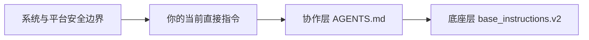

<div align="center">

<h1>What Your Codex Needs</h1>

<p><strong>把 Codex 调教成靠谱工程同事的两层配置方案</strong><br>
<sub>不拍电报 · 不偷懒跳测试 · 不打防御官腔 · 知道什么时候该动手、什么时候该停下</sub></p>

<p>
  <a href="./AGENTS.md"></a>
  <a href="./base_instructions.v2.md"></a>
  
  <a href="./README.en.md"></a>
</p>

<p>
  <a href="./AGENTS.md"><kbd>协作层 AGENTS.md</kbd></a>&nbsp;
  <a href="./base_instructions.v2.md"><kbd>底座层 v2 (EN)</kbd></a>&nbsp;
  <a href="./base_instructions.v2.zh.md"><kbd>底座层 v2 (中文对照)</kbd></a>&nbsp;
  <a href="#怎么用"><kbd>快速启用</kbd></a>&nbsp;
  <a href="./README.en.md"><kbd>English</kbd></a>
</p>

</div>

---

我希望 Codex 有自己的判断：一个按钮文案写错了，直接找准调用点改好并验证；公共接口要变，先查清影响面等我拍板；同一个报错卡住，换思路查根因，真推进不了再带着关键日志停下来；日常问它看法，先给结论和理由。

## 两层配置，各管各的事

<table>
  <tr>
    <td width="50%" valign="top">
      <h3><kbd>Layer 1</kbd> 协作层 · <code>AGENTS.md</code></h3>
      <p><sub>推荐所有人 · 不碰底层协议 · 跨版本稳定</sub></p>
      <ul>
        <li><strong>沟通方式</strong>：结论先行、分清事实/假设/推断、删客套</li>
        <li><strong>工作流</strong>：新功能走<strong>双 Plan</strong>，小修复直接动手</li>
        <li><strong>止损熔断</strong>：同思路连败 2 次换路，2 轮替代仍卡即停</li>
        <li><strong>工程底线</strong>：不擅自 commit/push、先查调用点再改</li>
      </ul>
      <p>→ <a href="./AGENTS.md"><strong>阅读 AGENTS.md</strong></a>（<a href="./AGENTS.en.md">English</a>）</p>
    </td>
    <td width="50%" valign="top">
      <h3><kbd>Layer 2</kbd> 底座层 · <code>base_instructions.v2</code></h3>
      <p><sub>进阶可选 · 替换默认系统提示词 · 保留全部工具契约</sub></p>
      <ul>
        <li><strong>治电报体</strong>：废除标点与对比句黑名单，恢复自然人话</li>
        <li><strong>治偷懒</strong>：反转默认跳测试，改为按风险补精简测试</li>
        <li><strong>去官腔</strong>：取消无条件强制自曝，改为三类可判定披露</li>
        <li><strong>补护栏</strong>：禁为跑通程序削弱安全，补可数止损与提问兜底</li>
      </ul>
      <p>→ <a href="./base_instructions.v2.md"><strong>英文生产版</strong></a> · <a href="./base_instructions.v2.zh.md">中文对照版</a></p>
    </td>
  </tr>
</table>



> [!TIP]
> **不知道怎么选？先只用 `AGENTS.md`。**
> 它能解决 80% 的协作磨合问题，且不绑定 Codex 内部工具签名。两层同时启用时，细节尺度（如 Git 提交限制或熔断次数）自动以你的 `AGENTS.md` 和当前指令为准。

---

## 协作层：三句话，看它怎么干活

| 你怎么说 | 你希望 Codex 怎么做 | 对应规则 |
| :--- | :--- | :--- |
| **「把保存按钮上的错字改了。」** | 找界面实际调用的文案，改好并验证；旁边顺眼想重构的组件留给下一个任务。 | <kbd>最小改动半径</kbd> |
| **「把接口的 `name` 改成 `displayName` 吧。」** | 先查清哪些调用方还在读 `name`，给**一个首选迁移方案**，讲清影响和风险，等你拍板。 | <kbd>高风险先确认</kbd> |
| **「怎么又是同一个报错？」** | 同一思路连败 2 次换路；换过 2 次仍失败立刻停手，交出已试方案、卡点和关键报错。 | <kbd>调试熔断</kbd> |

做新功能或行为仍有关键取舍时，启用 **双 Plan**：先对齐「做什么」（用户场景、核心流程、范围与可见验收标准），确认后再对齐「怎么做」（改动模块、依赖顺序与验证方法）；需求已定的小修复直接落地。[查看双 Plan 细则 →](./AGENTS.md#双-plan)

---

## 底座层：原版系统提示词的痛点与 `v2` 改造对照

只靠 `AGENTS.md` 有时压不住官方默认 `base_instructions` 里“打地鼠式补丁”带来的底层习惯。下面用红绿对比直接看 `v2` 改掉了什么：

```diff
# 1. 文风与句法：废除标点/对比黑名单，治好电报体与语义删失
- In prose, do not use semicolons or colons; NEVER use contrastive framing ("X, not Y").
- Never state what something is not or what will remain unchanged.
+ Use colons, semicolons, transitions, and brief contrasts whenever they clarify causality or scope.
+ Cut only filler, self-praise, invented jargon, and unsolicited advice.

# 2. 验证与测试：反转默认跳测试，打破偷懒闭环
- Skip new tests unless requested, required by the repo, or catching a missed regression.
+ Use declared repo check entry points (README/scripts/Makefile/CI) and verify baseline attribution.
+ Add focused tests for bug fixes, non-trivial logic changes, and regression risks; skip only for trivial/covered/opt-out cases.

# 3. 结尾披露、安全底线与止损：去掉防御官腔，补齐硬护栏
- Mention any flaws or unguided decisions; you MUST repeat any such disclosures in final.
- Only forbids hypothetical-risk warnings (no rule against weakening auth/TLS to make tests pass).
+ Disclose only 3 checkable items when present: behavioral assumptions, unverified areas, unresolved risks.
+ Never disable auth, validation, TLS, or sandboxes to make code pass (explicit local/test mocks excepted).
+ Switch hypothesis after 2 failures; pause and report after 3 distinct hypotheses fail without progress.
```

> [!NOTE]
> **关于引用范围**：出于版权与维护边界，本仓库不托管 OpenAI 原版系统提示词全文。上文仅提炼原版中引发三类典型问题的机制片段作为改造依据（在实测中，原版禁用对比句甚至导致 Codex 在翻译自身提示词时把 *"not as a continuation of intermediate commentary"* 与 *"rather than replacing it"* 整半句删丢，且原版自身在插件列表里违反了“列表标签后禁用冒号”禁令）。

<details>
<summary><strong>展开查看：`v2` 完整保留的 Codex 底层契约与剪裁原则</strong></summary>

<br>

**剪裁尺子**：任何仓库都成立的原则留在底座；只在特定项目或个人习惯下成立的细节交给 `AGENTS.md` 或 `SKILL.md`。同时修正了原版两处拼写失误（`maketo`、`tools_search`）并去除 7 处以上高频重复，全文精简约 20%。

| 契约维度 | `v2` 完整保留内容 |
| :--- | :--- |
| **双频道与协作** | `commentary` / `final` 分工、调工具前先发 `commentary`、最终答复独立自洽；`functions.request_user_input_async` / `functions.send_message_to_user_async`、等待窗口、中途纠偏（steering）、自动压缩连续性，外加异步工具不可用时退回 `final` 兜底 |
| **格式与可视化** | GitHub 风格 Markdown、CommonMark 空行规范、本地文件可点击链接（空格尖括号、禁反引号与 URI、禁行号范围）、四层可视化分流（交互/内联、独立绘图文件、Mermaid、表格/列表） |
| **工具与 Shell** | `rg` / `rg --files`、`functions.exec` 的 `await Promise.allSettled([...])` 并发只读、禁占位分隔输出、`JSON.stringify()` 非 shell 转义警示、`gh --body-file` 换行与字面转义保真、60 秒阻塞休眠/轮询上限、勿覆盖 `$HOME`/`$home`/`$CODEX_HOME` |
| **扩展与前端** | Skills（`r0` 别名展开、环境托管与编排器 `skills.list` / `skills.read` / `skill://`）、Apps（`codex_apps` / `tool_search` / 禁用 `list_mcp_resources*`）、Plugins（`plugin_name:` 与 MCP `provenance`）、前端写实素材/文案克制/交互状态与可达性、完整 65 字体目录 |

</details>

---

## 怎么用

### <kbd>步骤 1</kbd> 配置 `AGENTS.md`（推荐所有人）

1. 打开 [AGENTS.md](./AGENTS.md)，删改你不认同的条款（例如调试熔断次数、是否启用双 Plan）。
2. 全局生效放进 `~/.codex/AGENTS.md`；单项目生效放进项目根目录 `AGENTS.md`（已有同名文件则按章节合并，保留项目原有构建与测试命令）。详见 [Codex 官方 AGENTS.md 指南](https://developers.openai.com/codex/guides/agents-md)。

### <kbd>步骤 2</kbd> 替换底层 `base_instructions`（进阶可选）

1. 将 [base_instructions.v2.md](./base_instructions.v2.md) 复制到 `~/.codex/base_instructions.v2.md`。
2. 在 `~/.codex/config.toml` 中启用 `model_instructions_file`：

```toml
# 相对路径以 config.toml 所在的 .codex/ 目录为基准
# 旧配置项 experimental_instructions_file 已弃用
model_instructions_file = "base_instructions.v2.md"
```

3. 新开一个 Codex 会话，拿手头一个小任务实测（如修一个表单提示或小 bug），检查它是否找准了真实调用点、保持改动克制、跑通验证并把结果说清。

> [!TIP]
> **中文用户的最佳组合**：底层加载英文版 `base_instructions.v2.md`（与原生工具协议和模型训练分布最贴合），外层放中文 `AGENTS.md` 统一中文沟通风格和个人协作纪律。

---

## 版本与兼容性

> [!WARNING]
> `base_instructions.v2.md` 基于 2026 年 11 月的 Codex 工具与频道协议整理（实测环境 `codex-cli 0.172.0`）。由于 `model_instructions_file` 会整份替换官方内置底座，Codex 后续大版本升级若修改内置工具名或 Skills/Apps 协议，旧覆写文件可能导致新能力失效；升级后请对照新版官方指令核对工具契约段。
