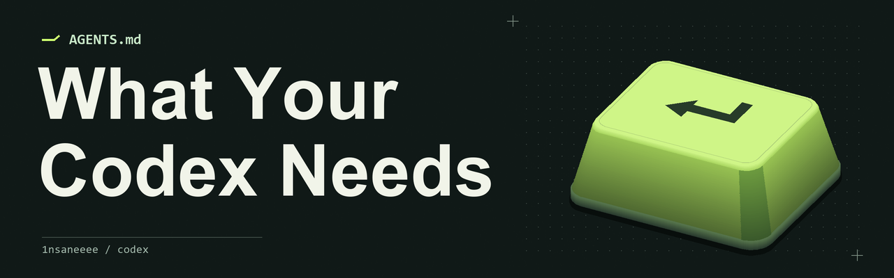

# 我怎么和 Codex 一起干活

我希望 Codex 有自己的判断。一个按钮文案写错了，直接改就好。公共接口要变，先告诉我会影响谁。同一个错误试了半天，停下来，把最有用的那行日志给我看。

我把这些合作习惯写成了一份中文 `AGENTS.md`。日常对话也算在里面。我问你怎么看，你得先说自己的判断，再告诉我为什么。

**[读完整规则 →](./AGENTS.md)**　·　[直接看用法](#怎么用)

## 三句话，看它怎么干活

| 我怎么说 | 我希望 Codex 怎么做 |
| :--- | :--- |
| **「把保存按钮上的错字改了。」** | 找到界面实际使用的文案，改好并检查结果。如果旁边的组件也能重构，把它留给另一个任务。 |
| **「把接口的 `name` 改成 `displayName` 吧。」** | 查清哪些调用方还在读 `name`，给一个首选迁移方案，说明影响和风险，等我拍板。 |
| **「怎么又是同一个报错？」** | 同一思路连续失败两次就换路。换过两次、第二个替代方案仍失败，就停手，把试过什么、卡在哪里和关键报错一起给我。 |

做新功能时，我还会用 **双 Plan**。先给我看用户会怎么用、做到什么算完成。我确认以后，再讨论改哪些模块、怎么验证。一个小修复用不上这两轮。[读双 Plan](./AGENTS.md#双-plan)

## 怎么用

1. 打开 [AGENTS.md](./AGENTS.md)，挑出你愿意在自己项目里执行的条款。比如，你希望 Agent 调试多久才叫你？先把这个判断写成自己的规则。
2. 把选好的条款放进项目根目录的 `AGENTS.md`。已有同名文件，就合并进对应章节，保留项目自己的构建命令和约定。想跨项目使用的偏好，可以放进 Codex 主目录下的 `AGENTS.md`，默认路径是 `~/.codex/AGENTS.md`。[官方加载说明](https://developers.openai.com/codex/guides/agents-md)
3. 新开一个 Codex 会话，拿你手头一个小任务试。比如让它修一个表单提示，看它能否找到实际调用点，完成局部修改，再说清楚它究竟验证了什么。
